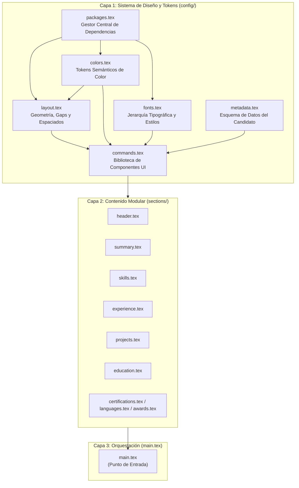

# Arquitectura del Framework — BERF

**BERF (Backend Engineer Resume Framework)** está diseñado siguiendo los principios de la ingeniería de software moderna: **alta cohesión**, **bajo acoplamiento** y un **sistema de diseño desacoplado** basado en tokens.

---

## 1. Topología del Sistema

El framework está dividido en tres capas de abstracción:



---

## 2. Orden Estricto de Carga en `main.tex`

El orden en el que se importan los módulos en el preámbulo es determinista para evitar referencias no resueltas:

1. **`config/packages.tex`**: Debe cargarse primero; inicializa todos los paquetes requeridos (`fontspec`, `geometry`, `xcolor`, `hyperref`, `fontawesome5`, etc.).
2. **`config/colors.tex`**: Define la paleta base y los tokens semánticos (`cvPrimary`, `cvAccent`, etc.) consumidos por el layout y los estilos.
3. **`config/fonts.tex`**: Define los tamaños y macros tipográficas (`\cvNameStyle`, `\cvSectionStyle`, `\cvMonoStyle`).
4. **`config/layout.tex`**: Aplica la geometría del documento (`\geometry`), define los tokens de separación vertical (`\cvSpacing*`, `\cvSectionGap`) y configura `\hypersetup`.
5. **`config/metadata.tex`**: Almacena las variables del perfil profesional y programa la inyección de metadatos PDF en `\AtEndPreamble`.
6. **`config/commands.tex`**: Construye las macros de componentes reutilizables consumiendo todos los tokens previos.

---

## 3. Catálogo de Componentes (`config/commands.tex`)

### `\cvHeader`
* **Descripción**: Renderiza el bloque superior del currículum con nombre, título y matriz de enlaces de contacto e iconos.
* **Tokens consumidos**: `\cvName`, `\cvHeadline`, `\cvLocation`, `\cvEmail`, `\cvPhone`, `\cvLinkedinUrl`, etc.

### `\cvSection{<Título>}`
* **Descripción**: Encabezado de sección en mayúsculas acompañado de una línea divisoria horizontal en color acento.
* **Espaciado**: Antepone `\cvSectionGap` y pospone `\cvParagraphGap`.

### `\cvExperienceItem{rol}{empresa}{ubicacion}{periodo}{resumen}{viñetas}`
* **Descripción**: Fila de experiencia a doble columna optimizada para evitar roturas de página indeseadas (`minipage`).
* **Sintaxis**:
  ```latex
  \cvExperienceItem
      {Senior Backend Engineer}
      {Empresa}
      {Ubicación}
      {2022 -- Presente}
      {Resumen del alcance o rol}
      {
          \begin{cvItemize}
              \item Logro orientado a métricas...
          \end{cvItemize}
      }
  ```

### `\cvProjectItem{nombre}{url}{display_url}{tech_stack}{año}{viñetas}`
* **Descripción**: Presentación de proyectos y sistemas de código abierto con enlace a repositorio y badge de tecnologías.

### `\cvTag{<Tecnología>}`
* **Descripción**: Genera una píldora visual en fuente monoespaciada con fondo sutil (`cvBackground`) para nombres de lenguajes, herramientas y plataformas.

### `\cvSkillCategory{<Categoría>}{<Contenido>}`
* **Descripción**: Fila a dos columnas con el nombre de la categoría a la izquierda y el listado de habilidades a la derecha.

### Entorno `cvItemize`
* **Descripción**: Entorno de viñetas basado en `enumitem` con espaciado vertical ultra-compacto (`nosep`), viñeta en color acento y sangría controlada.

